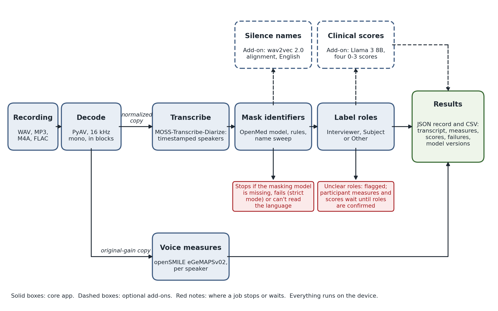

# Summary

ClinicalWhisper is an MIT-licensed, local-first research pipeline, built to study anhedonia, that converts sensitive audio into speaker-attributed transcripts with identifiers masked. It runs as a desktop app on Apple Silicon Macs, and recordings can be batch-processed from the command line. Researchers who only need local transcription can install the core app alone, built on MOSS-Transcribe-Diarize [@moss2026]; optional add-ons give exploratory clinical scores that have not been externally validated. Anhedonia appears in bipolar disorder, schizophrenia and major depressive disorder, so a score cannot point to a specific diagnosis [@whitton2015; @husain2018]. Voice and timing measures could also reflect psychomotor retardation, which in depression shows up in speech as longer pauses and less varied prosody [@sobin1997; @alpert2001]. Each recording's full results are saved as a JSON file, and a batch also produces a summary CSV with one row per recording, so measures from many interviews can go straight into statistical analysis.

# Statement of need

Clinical interviews contain identifying information that must stay in a secure environment, and also analytically useful signals: the words spoken, who is speaking, how long a person takes to respond and when the delay occurs, and changes in voice and tone. When a delay occurs may matter: a longer pause after a question about something positive could carry a signal. ClinicalWhisper currently measures response latency overall and counts the words a participant says after positive, neutral and negative questions. Existing tools either process audio locally without de-identification or send it to a cloud service. Labs may have to manually listen to hours-long audio and then remove identifying information by hand [@campbell2023; @saunders2015].

The tool is for researchers with noisy interview audio who need speaker-separated transcripts without identifiers. The scores are research measures, not clinical assessments, as the tool states with its results; judgments about a person belong to a qualified clinician.

# State of the field

Speech recognition models such as Whisper [@radford2023] transcribe speech, and speaker diarization toolkits such as pyannote.audio [@bredin2023; @plaquet2023] and NVIDIA NeMo [@nemo] separate speakers; none of them masks identifiers. Table 1 compares ClinicalWhisper with open-source tools that combine some of these steps, based on their code and documentation in November 2026. Text de-identification tools mask a transcript once it exists, which is also how ClinicalWhisper's main masking works. The closest tool is senselab [@senselab], a Python library whose 2026 pre-releases add identifier detection and audio redaction to transcription, speaker separation and openSMILE features. OpenWillis [@worthington2024] labels clinician and participant in two-speaker recordings of supported rating-scale interviews, and Batchalign [@liu2023] now ships a desktop app. ClinicalWhisper is the only one of these tools that combines identifier masking and speaker separation in a desktop application; by default it stops a job rather than write an unmasked transcript, and it withholds participant measures until the speakers' roles are clear or confirmed.

| Tool | Speaker separation | Identifier masking | Interviewer and participant roles | Desktop app |
|:---|:---|:---|:---|:---|
| WhisperX [@bain2023] | Yes | No | No | No |
| Batchalign [@liu2023] | Yes | No | No | Yes |
| OpenWillis [@worthington2024] | Yes | No | Two-speaker rating-scale interviews | No |
| senselab [@senselab] | Yes | Pre-release only | No (a pre-release check flags an examiner's voice) | No |
| Presidio [@presidio], Philter [@norgeot2020] | No (text or image input) | Text and images (Presidio); text (Philter) | No | No |
| ClinicalWhisper | Yes | Yes; the job stops if masking fails | Interviews and groups | Yes (macOS) |

Table: Open-source tools that cover parts of ClinicalWhisper's work, from their code and documentation in November 2026.

# Software design

PyAV decodes audio in blocks and resamples it to 16 kHz mono PCM without loading an entire long interview into memory. Preprocessing makes two temporary copies: a level-normalized one for transcription, which helps with quiet recordings, and an original-gain one for acoustic analysis, so loudness measures are unchanged.

MOSS returns timestamped speaker segments. Long recordings are transcribed in five-minute windows that overlap by 30 seconds, and speakers are linked across windows by the overlap and by voice. One pass slows as the audio grows, and on five AMI meetings [@carletta2006] it dropped 20 minutes of a 48-minute meeting and the last 4 minutes of a 36-minute one; windows lowered the pooled word error rate from 0.38 to 0.26, while on the other three meetings word error was unchanged and speaker attribution was worse. Five minutes gave the lowest speaker-attributed error of the lengths tried (0.25, against 0.30 and 0.31 for three and four minutes), and a 30-second overlap did better than 15 seconds (0.29) (`evals/reports/transcription_accuracy.md`). The window length was chosen on these same meetings and the speaker linking tuned on three of them, and their audio was rebuilt from annotated utterances, which is easier than a raw recording; windowed mode also found too many speakers unless their number was given. Identifier masking is on by default: each segment passes through the OpenMed model, rule-based patterns catch identifiers it missed, and a name found once is masked everywhere it recurs. Outside English, the scoring model, when installed, runs a second name check. The job stops if the scrubber is missing or, in the default strict mode, if scrubbing fails, and recordings in a detected language it cannot mask are refused. On 300 synthetic English sentences built from 25 sentence frames, the masker caught 98.0% of identifiers before its last three rules were added, against 74.3% for Microsoft Presidio with default settings (`evals/masking/README.md`). Presidio's defaults skip organisations, and most of its misses were organisations, phone numbers and spoken email addresses; on names, places, dates and ages alone, the figures were 99.1% and 94.2%. Outside English, with the Languages and Scoring add-ons, ClinicalWhisper 5.3 caught 74 to 100% of synthetic names and cities (57 to 92% without the Scoring add-on's name check). The sentences were typed rather than transcribed, so they do not test names the transcriber mishears. An optional add-on writes a listening copy of the audio in which every masked word is silenced, using word-level alignment with a wav2vec 2.0 model [@baevski2020], in English only. A segment that cannot be aligned is silenced whole, but a name the text scrubber missed remains audible. Automated scrubbing can miss identifiers and is not a legal guarantee of de-identification. The silenced audio still contains every voice, and HIPAA lists voice prints among the identifiers that must be removed [@hhs2012], so the audio copy is not de-identified. openSMILE [@eyben2010] computes the 88 eGeMAPSv02 features [@eyben2016] from the original-gain signal, for the whole recording and for each anonymous speaker. The tool reports six of them: the mean and variation of pitch and of loudness, because flatter, less varied speech is among the most reported voice changes in depression [@cummins2015], and jitter and shimmer, the cycle-to-cycle irregularity of pitch and loudness, which have shown weak correlations with depression severity and psychomotor slowing [@quatieri2012]. It also reports VTA, an index combining pitch and loudness variation.

A role classifier labels each anonymous speaker as Interviewer, Subject or Other in an interview, or Moderator, Participant or Other in a group (\autoref{fig:speakers}), by combining conversation structure (questions, handing over the floor, who speaks first) with lines from the interview guide and consent script and, optionally, staff voices that a user chose to remember, stored on the device and never in results or exports. With three or more active speakers it treats the recording as a group and gives no clinical scores; when the evidence is unclear, it flags the job with the reason, and participant measures and scores wait until roles are confirmed in the Speakers panel. Roles can be corrected and rescored without repeating transcription. The role classifier has not yet been evaluated against annotated roles. Long transcripts are scored in windows of about 2,800 words, sized to fit the local model's 8,000-token context and split at turn boundaries, because a line cut in half would lose who said it; per-window scores, errors and coverage stay in the JSON record. Four scores (interest and pleasure, low mood, flat affect in language, and engagement) are rated 0 to 3 with written anchors by a local Llama 3 8B model [@grattafiori2024] in the Scoring add-on, and each must quote the participant's own words; a score without a quote is left missing. The rating prompt and anchors are in the repository (`llm_clinical_scorer.py`), so they can be inspected or adapted. Interest and pleasure and low mood are modeled on the two core symptoms of major depression in the DSM [@apa2013], items 1 and 2 of the PHQ-9 [@kroenke2001] and the two items of the PHQ-2 [@kroenke2003], without the questionnaires' two-week time frame. Low mood is scored separately so that analyses can account for it when studying loss of interest; both scores come from the same model reading the same transcript, so how well they separate has not been tested. Flat affect and engagement rate how the participant speaks and takes part, rather than what they report. Hesitancy, psychomotor signs and elaboration, rated by the model in earlier versions, are now measured from segment timing and word counts instead. Llama 3 8B was chosen because its 4-bit build (5.3 GB) runs on a laptop, so transcripts stay on the device; the model is a setting, and the stability figures below apply only to it. In five repeated runs on each of 13 synthetic transcripts (sampled at temperature 0.7), ratings were stable for interest and pleasure (ICC 0.96, 8 of 13 transcripts rated in every run) and low mood (0.83, 5 of 13), moderately stable for engagement (0.69) and unstable for flat affect (0.31) (`evals/reports/reliability_v2.md`). These values describe how stable the ratings are, not whether they are correct.

![The Speakers panel on a two-minute excerpt of AMI meeting ES2004a [@carletta2006], with sample lines and a suggested role for each speaker.\label{fig:speakers}](figures/speakers_panel.png)

In the desktop app, all files are transcribed before the scoring model loads; the command-line processor alternates the two models in groups of about two hours of audio, so they are never in memory together, and saves each file as it finishes, so an interrupted run can resume. Source audio can be kept, archived or deleted after analysis. Each output records the app version (and the source commit when run from a checkout), Python and package versions, platform, scoring settings and model revisions.

# Research impact statement

The pipeline that preceded ClinicalWhisper 5 (Whisper large-v3, pyannote and openSMILE) extracted voice features from interviews in DAIC-WOZ, a restricted-access clinical interview dataset [@gratch2014daic], to predict PHQ-8 items 1 and 2, the interest and mood items, as reported in a preprint [@zhou2026preprint]. That study does not test the current transcription, masking or scoring stages. The transcription, masking and rating-stability evaluations described above are in the repository's `evals` folder with their scripts, test sentences and results, so they can be rerun. A second research group received ClinicalWhisper 5.3 in October 2026 to test it on noisy home recordings. ClinicalWhisper 5.3 has also been used to process three focus-group sessions with visually impaired adults, held to inform the design of a visual assistive device.

# AI usage disclosure

Software and documentation. Most of the implementation and documentation, including the repository README files, was drafted with AI coding agents: Google Antigravity (Gemini 3.1 Pro and Claude Opus 4.6) and Anthropic Claude Code (Claude Opus 5). Jinghao Yu's contributions (reporting of failed scoring runs, the scorer's model option, and the English and Chinese README updates for version 5.3) were also made with OpenAI GPT-5.6, and he checked them against the code and the tests. Chengdong (Peter) Zhou provided the software design and direction: the privacy-first, local-only architecture; selection of models and features; clinical framing; and review of the software's operation. The implementation was checked with the test suite and the evaluations described above. The human authors remain responsible for the design decisions, scientific claims and released software.

Manuscript. Jinghao Yu drafted an early version of the manuscript with OpenAI GPT-5.6, and OpenAI Codex (GPT-5) assisted with repository inspection and bibliography verification. The current text is Chengdong Zhou's revision, dictated and then edited with Claude Opus 5.5 (Claude Code), which also checked claims against the code, verified references and converted the manuscript to the JOSS format; the authors reviewed every change.

# Acknowledgements

The authors thank Laurent Itti (iLab, Thomas Lord Department of Computer Science, USC Viterbi School of Engineering, University of Southern California) for his support of this work, and the University of Southern California for institutional and computational resources.

# References
